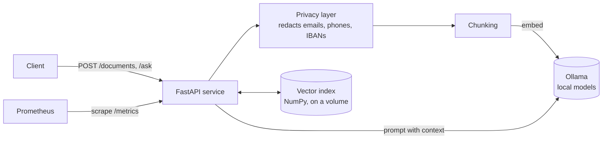

# local-rag-stack


A self-hosted question-answering service over your own documents. Everything
runs locally in Docker, so **no data leaves your machine**, and a small
privacy layer removes personal data **before** any text reaches the language model.

Built as a compact example of the things a production AI platform needs:
retrieval (RAG), local model serving, a data-protection layer, containers,
CI and monitoring.

## Architecture



**Ingest:** text is redacted, split into overlapping chunks, embedded with
`nomic-embed-text` and stored in a persistent index.

**Ask:** the question is redacted and embedded, the closest chunks are
retrieved, and a small local model (`qwen2.5:0.5b` by default) answers using
only that context, citing its sources.

## Quick start

Requirements: Docker with Compose. The first start downloads about 1 GB of models.

```bash
docker compose up -d --build        # Ollama + API + Prometheus
make ingest                         # load sample_docs/handbook.md
make ask Q="How many vacation days do I get?"
```

Example response:

```json
{
  "answer": "Full-time employees get 30 days of paid vacation per year [1].",
  "sources": [{"id": 1, "source": "handbook.md", "score": 0.71, "excerpt": "..."}],
  "redacted": {},
  "seconds": 1.8
}
```

- API docs (Swagger): http://localhost:8000/docs
- Metrics: http://localhost:8000/metrics
- Prometheus: http://localhost:9090

Use a bigger model by setting `CHAT_MODEL`, e.g. `CHAT_MODEL=llama3.2:3b docker compose up -d`.

## API

| Method | Path | Purpose |
|---|---|---|
| `GET` | `/health` | Service status and whether the model server is reachable |
| `POST` | `/documents` | Ingest `{"source", "text"}`; re-ingesting a source replaces it |
| `GET` | `/documents` | List ingested sources |
| `DELETE` | `/documents/{source}` | Remove a source from the index |
| `POST` | `/ask` | Ask `{"question", "top_k"?}`; returns answer, sources, redaction counts |
| `GET` | `/metrics` | Prometheus metrics (requests, redactions, latency) |

## Privacy layer

`app/redact.py` replaces emails, phone numbers and IBANs with typed
placeholders (`[EMAIL]`, `[PHONE]`, `[IBAN]`) in both documents and questions.
It runs before chunking, so personal data is never embedded, stored or sent
to the model. The tests check this directly by inspecting the exact prompt
that would reach the model.

It is rule-based on purpose: predictable, fast and easy to audit. A real
system would add named-entity recognition for names and addresses.

## Development

```bash
make dev     # create .venv and install dependencies
make test    # 20 tests, no model server needed
make lint    # ruff
```

Tests use a deterministic fake model, so CI runs in seconds without GPUs or
downloads. GitHub Actions lints, tests and builds the Docker image on every push.

## Design decisions

- **NumPy instead of a vector database.** For a few thousand chunks a brute-force
  search takes milliseconds and means one service less to run. `VectorStore`
  has a small interface so it can be swapped for Qdrant or pgvector.
- **Ollama for inference.** Runs on CPU, easy to swap models, keeps data local.
- **Embed first, then replace.** Re-ingesting a document only removes the old
  version after the new one has been embedded, so a model outage can't wipe data.
- **Non-root container** with a health check.

## Next steps

- Named-entity recognition for names and addresses in the privacy layer
- Multi-tenant indexes with per-tenant API keys
- Evaluation set to measure answer quality when changing models
- Streaming responses

## About

Built by Muhammad Rafeh with AI-assisted development (Claude). I designed,
reviewed and tested the code, and can walk through every part of it.
